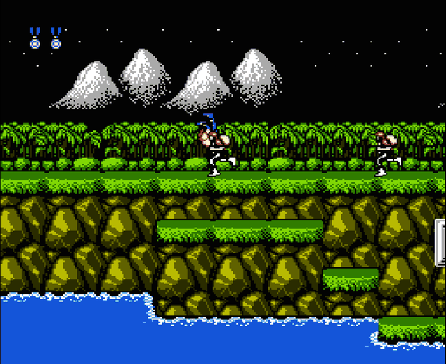
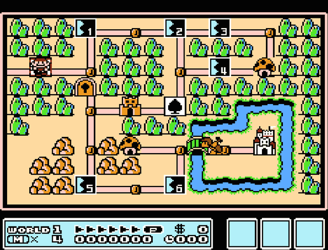
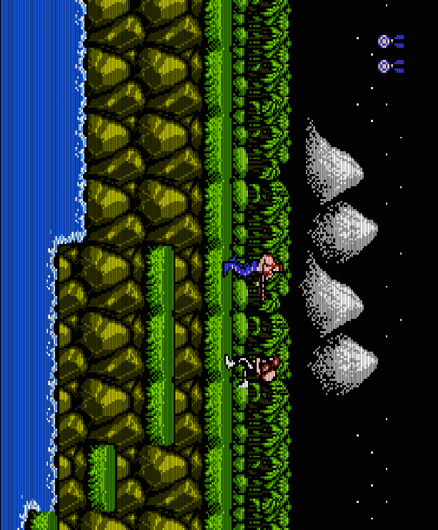
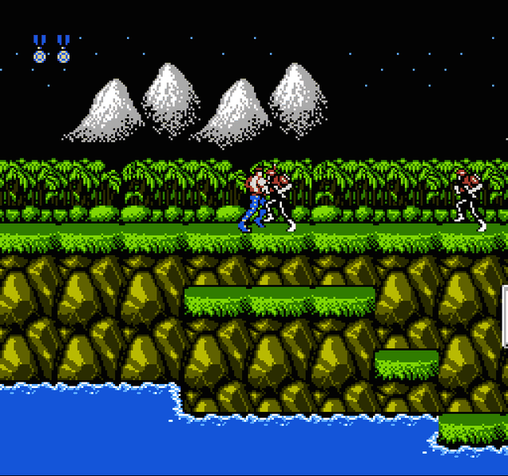

# replica-NES

Emulador de la consola NES escrito en Rust: app nativa de escritorio con interfaz gráfica y, más adelante, versión web (WebAssembly).

> El estado de cada funcionalidad y lo que queda por hacer está en [docs/ROADMAP.md](docs/ROADMAP.md).

| <br><sub>Contra</sub> | <br><sub>Super Mario Bros. 3 — mapa</sub> | <br><sub>Girada 90° con líneas de barrido</sub> | <br><sub>Contra en Linux</sub> |
|:---:|:---:|:---:|:---:|

## Qué es

`replica-NES` carga una ROM en formato iNES (`.nes`) y la ejecuta emulando el hardware de la consola: CPU 6502, PPU (vídeo), APU (audio) y los mappers de los cartuchos.

La emulación la aporta [`tetanes-core`](https://crates.io/crates/tetanes-core), un core probado y preciso. Este proyecto construye el producto alrededor: ventana, interfaz, audio, controles, guardado y versión web.

## Tecnologías

| Pieza | Tecnología |
|---|---|
| Lenguaje | Rust 2024 (estable) |
| Emulación | [`tetanes-core`](https://crates.io/crates/tetanes-core) — CPU 6502, PPU, APU y mappers; crate de crates.io, sin cambios |
| Ventana e interfaz | `eframe` / `egui` 0.37, render con `wgpu` (Vulkan, DirectX 12, Metal o WebGL2) |
| Audio | `cpal` 0.18; el core genera las muestras a la frecuencia de la tarjeta (`set_sample_rate`) |
| Mandos | `gilrs` 0.11: mandos USB y Bluetooth (XInput, DirectInput, evdev), botones reasignables |
| Diálogo de archivos | `rfd` |
| Configuración | `serde` + `ron`, guardada por `eframe` en la carpeta de datos del usuario |
| Icono del ejecutable | `winresource` (incrusta `assets/icon.ico` en el `.exe` de Windows) |
| Web | `trunk` + `wasm32-unknown-unknown`, `wasm-bindgen` y `web-sys` |
| CI y publicación | GitHub Actions: formato, `clippy`, tests, compilación web y ejecutables de Windows y Linux (Ubuntu 22.04, glibc 2.35) que se abren 15 s en la CI antes de publicarse |

## Probado con

| Juego | Hasta dónde se probó | Windows | Linux |
|---|---|:---:|:---:|
| [Contra](docs/capturas/contra.png) | Partida en el nivel 1: correr, saltar y disparar | ✅ | ✅ |
| [Super Mario Bros. 3](docs/capturas/smb3.png) | Pantalla de título, menú y mapa del mundo 1 | ✅ | ✅ |

Detalles, método y limitaciones conocidas en [docs/PRUEBAS.md](docs/PRUEBAS.md).

## Inicio rápido

**Con el ejecutable:** descarga el de tu sistema desde [Releases](https://github.com/DEIMER-PY/replica-NES/releases) y ábrelo. No necesita instalación.

El paso a paso para cada sistema operativo, los requisitos mínimos y dónde conseguir juegos están en [docs/INSTALACION.md](docs/INSTALACION.md).

**Desde el código fuente.** Requisitos: [Rust](https://rustup.rs) estable (ver `rust-toolchain.toml`) y, en Windows, las C++ Build Tools de Visual Studio.

```sh
git clone https://github.com/DEIMER-PY/replica-NES.git
cd replica-NES
cargo run -p nes-app --release
```

Para abrir una ROM directamente: `cargo run -p nes-app --release -- ruta/al/juego.nes`.

Versión web (requiere `trunk` y el target `wasm32-unknown-unknown`, ver [docs/WEB.md](docs/WEB.md)):

```sh
cd crates/nes-app
trunk serve
```

## Funcionalidades

- Emulación de CPU, PPU, APU y más de 30 mappers mediante `tetanes-core`.
- Pantalla de inicio con biblioteca de juegos: elige tu carpeta de ROMs y ábrelas con un clic.
- Carga de ROMs por menú, arrastrar y soltar, línea de comandos y lista de recientes.
- Teclado para dos jugadores y mandos USB o Bluetooth, con teclas y botones reasignables.
- Sonido con volumen y silencio.
- Pausa, reinicio, avance rápido ×4 y save states en 4 ranuras.
- Guardado automático de las partidas con batería.
- Imagen: escalado entero, proporción de televisor 8:7, estirar, suavizado, líneas de barrido, giro de 90°/180°/270° y pantalla completa.
- Escritorio (Windows y Linux, ejecutables en Releases; macOS compilando desde el código) y navegador (WebAssembly).

## Documentación

| Documento | Contenido |
|---|---|
| [docs/INSTALACION.md](docs/INSTALACION.md) | Instalación en Windows, Linux y macOS, requisitos mínimos y dónde conseguir ROMs |
| [docs/PRUEBAS.md](docs/PRUEBAS.md) | Juegos probados en Windows y Linux, capturas y limitaciones conocidas |
| [docs/ARQUITECTURA.md](docs/ARQUITECTURA.md) | Diagramas, Crates, responsabilidades y flujo de un frame |
| [docs/HARDWARE-NES.md](docs/HARDWARE-NES.md) | Cómo funciona la NES: CPU, PPU, APU, mappers, formato iNES |
| [docs/GUIA-DESARROLLO.md](docs/GUIA-DESARROLLO.md) | Entorno, flujo de ramas y convención de commits |
| [docs/USO.md](docs/USO.md) | Cargar ROMs, controles y atajos |
| [docs/WEB.md](docs/WEB.md) | Versión web: compilar con `trunk`, diferencias y publicación |
| [docs/ROADMAP.md](docs/ROADMAP.md) | Funcionalidades hechas y pendientes |
| [CONTRIBUTING.md](CONTRIBUTING.md) | Cómo contribuir |
| [CHANGELOG.md](CHANGELOG.md) | Historial de cambios |

## ROMs

Este repositorio **no incluye ni distribuye ROMs**. Usa volcados de tus propios cartuchos o juegos homebrew de libre distribución. Los archivos `.nes` están excluidos en `.gitignore`.

## Licencia

[MIT](LICENSE). `tetanes-core` se distribuye bajo MIT o Apache-2.0.
