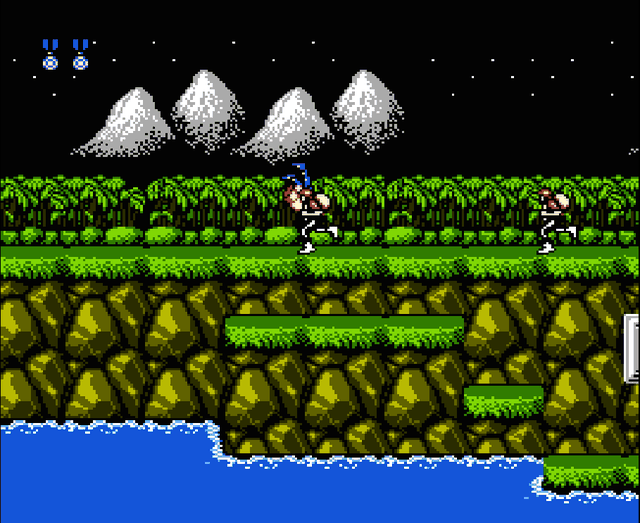
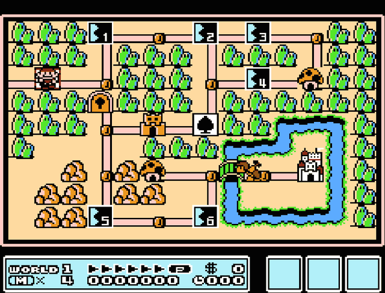
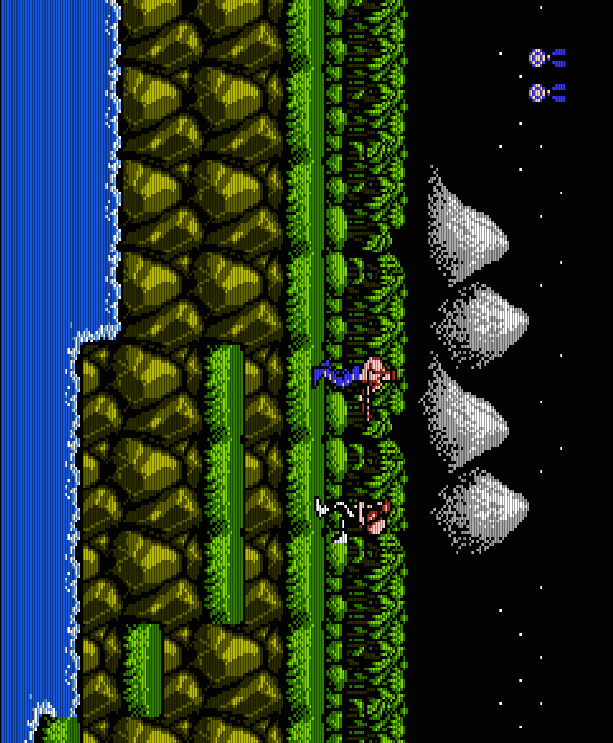
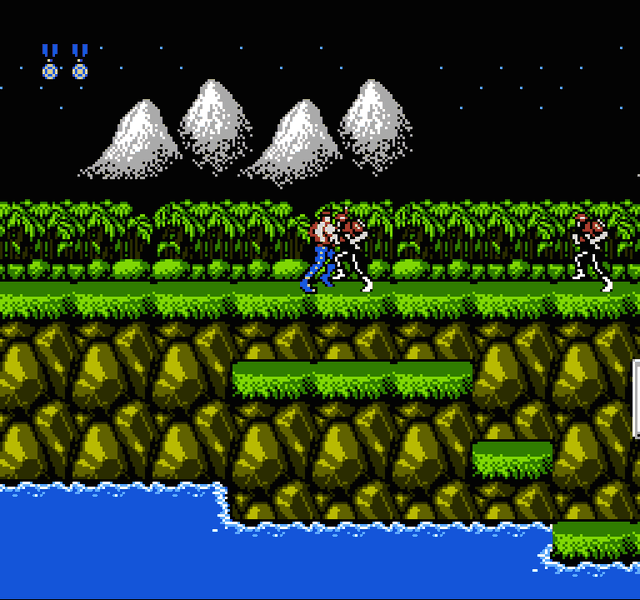

# Pruebas con juegos

Registro de las pruebas manuales con juegos comerciales de la NES. Complementan los tests
automáticos (`cargo test --workspace`), que usan la ROM de demostración del proyecto, y la prueba de la CI,
que abre cada ejecutable publicado durante 15 segundos antes de subirlo a la release.

Las ROMs son volcados propios y **no están en el repositorio**.

## Resultado

| Juego | Hasta dónde se probó | Windows | Linux |
|---|---|:---:|:---:|
| [Contra](capturas/contra.png) | Partida en el nivel 1: correr, saltar y disparar | ✅ | ✅ |
| [Super Mario Bros. 3](capturas/smb3.png) | Pantalla de título, menú y mapa del mundo 1 | ✅ | ✅ |

✅ funciona hasta ese punto · — no probado en ese sistema

## Cómo se probó

- **Windows 11:** el ejecutable compilado por la CI (`release.yml`), con la ROM pasada por línea de comandos.
  Un script de PowerShell pulsa teclas con `keybd_event` y captura la ventana.
- **Linux:** el mismo binario de Linux de la CI, en Ubuntu 24.04 (WSL2) con un servidor X virtual (`Xvfb`).
  Las teclas se envían con `xdotool` y las capturas se hacen con ImageMagick (`import`).
- Los mandos no se probaron con hardware: solo teclado.

## Capturas

|  Contra |  Super Mario Bros. 3 — mapa |  Girada 90° con líneas de barrido |  Contra en Linux |
|:---:|:---:|:---:|:---:|

## Limitaciones conocidas

- Los mandos están implementados (`gilrs`, con reasignación en **Ajustes → Controles**) pero no se han probado con un mando físico: las pruebas se hicieron con teclado.
